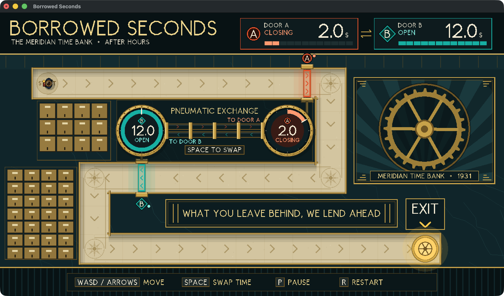
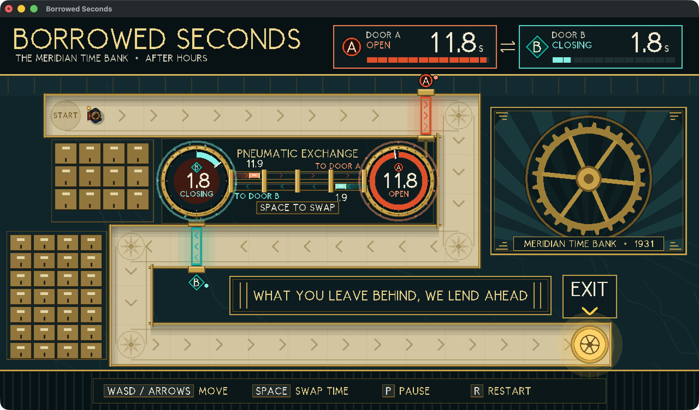
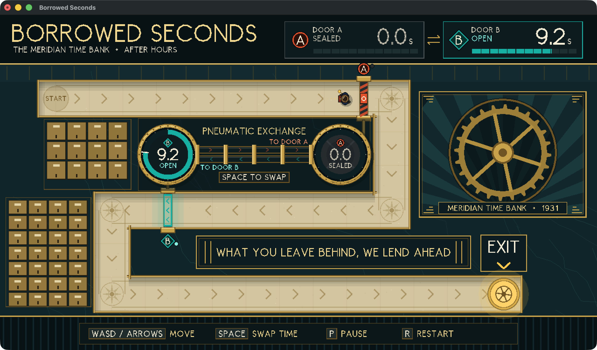
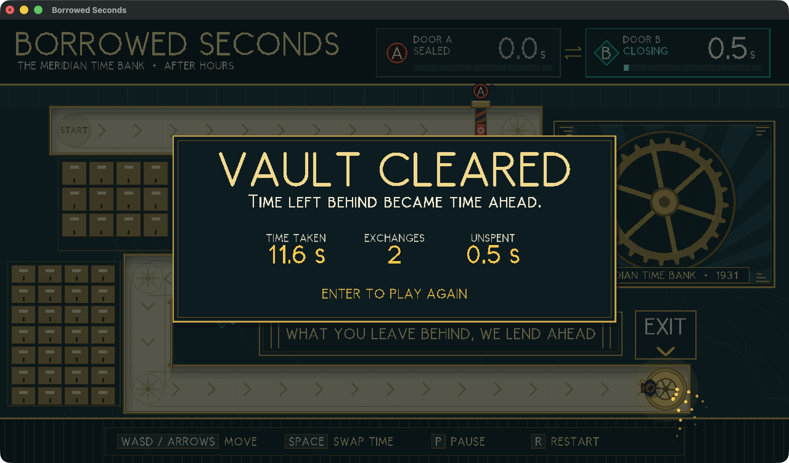
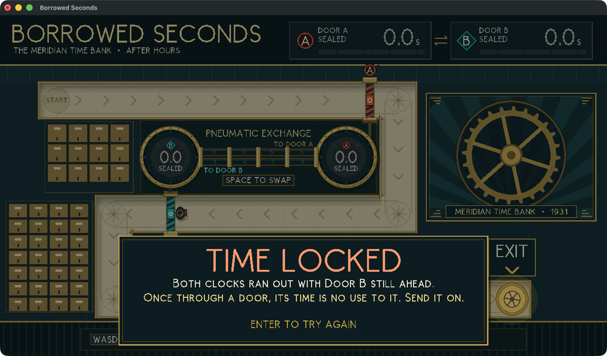

# Borrowed Seconds

*Time left behind can become time ahead.*

One complete level of a top-down puzzle, in Haskell with Gloss. Two doors each own a countdown, and Space exchanges what remains on them. It is a practice prototype for the University of Bristol CSS GameJam 2026, kept separate from any final submission. Nothing here has been published or submitted.

Whether pre-event code or AI-assisted code and art are allowed in an entry, and whether this approach would qualify for the functional-programming prize, are **not established**. Check the event rules before reusing any of it. All of this project's code and art were written with Claude, and `Platform.hs`, parts of `Draw.hs` and the base of `Font.hs` were adapted from the team's `borrowed-light` prototype.

| Initial state | Just after the first exchange |
|---|---|
|  |  |

## Run it

Needs GHC 9.6.7 and cabal-install 3.12.1.0 (`cabal.project` pins the compiler). On this machine they are in `~/.ghcup/bin`.

```bash
export PATH="$HOME/.ghcup/bin:$PATH"
```

```bash
cabal build all --enable-tests
```

```bash
cabal test spec --test-show-details=direct
```

```bash
cabal run exe:borrowed-seconds
```

The `exe:` prefix is required, because the library shares the name. Add `-- --demo` to watch the verified route play itself and then take the keyboard, or `-- --reduced-fx` to drop particles, trails, glows and the turning wheel.

### Controls

| Key | Action |
|---|---|
| WASD / arrows | Move |
| Space | Exchange the two doors' remaining time |
| P | Pause / resume |
| R | Restart |
| Enter | Start / retry |
| Window close button | Exit |

### Native runtime requirements

- **macOS (tested, arm64):** Apple's GLUT and OpenGL frameworks, which ship with the OS. Both are deprecated by Apple but present.
- **Windows x64 (the team's target, not tested):** Gloss's GLUT backend needs `freeglut.dll` beside the executable or on `PATH`. See "Outstanding checks on Windows".

### Toolchain actually used

macOS 26.5.2, arm64. Versions read from `dist-newstyle/cache/plan.json`.

| Component | Version |
|---|---|
| GHC | 9.6.7 |
| cabal-install | 3.12.1.0 |
| base | 4.18.3.0 |
| gloss | 1.13.2.2 |
| gloss-rendering | 1.13.2.1 |
| GLUT (Haskell binding) | 2.7.0.16 |
| OpenGL (Haskell binding) | 3.0.3.0 |
| containers | 0.6.7 |

## The mechanic

The exchange is one line, in [src/Game/Logic.hs](src/Game/Logic.hs):

```haskell
swapTimers :: DoorTimers -> DoorTimers
swapTimers (DoorTimers a b) = DoorTimers b a
```

The new pair is the old pair in the opposite order. So the sum is preserved, swapping twice restores the pair, and time is never created.

Timers are whole ticks at 60 per second. A door is open exactly when its timer is positive. `stepGame` runs each playing tick in this order: restart and pause, the swap, timers, movement, victory, and then whether the exit is still reachable.

A consequence worth knowing when designing further levels: each clock's *moment of expiry* is fixed when the level starts (here tick 120 and tick 720). A swap never changes those moments. It only changes which door each one applies to.

## Intended solution

1. Start. Door A has 2 s and is 3 s away, so it cannot be reached in time.
2. Press Space early. A now holds about 12 s and B about 2 s.
3. Walk through A.
4. Once clear of A, press Space again. A shuts behind you and B receives the roughly 9 s A had left.
5. Follow the corridor through B to the exit.

Through the real rules at full speed, the route exchanges at ticks 7 and 187 and wins at tick 695 (11.6 s). One exchange at any moment cannot win, and neither can none. The first exchange can come any time before you reach Door A, including after A has already shut, because that reopens it.

## How it fits together

```
src/Game/   pure core: no Gloss, no IO, compiled without a graphics dependency
  Types      DoorId, DoorTimers, GamePhase, PlayerState, TickInput, Level, GameState
  Level      the corridor, built from the plan's centreline, and its walls
  Collision  circle against rectangle, in small steps
  Logic      swapTimers, tickTimers, stepGame, initialGame, reachability check
  Input      key events into one TickInput per tick
  Clock      real time into whole ticks, with bounded catch-up
  Route      scripted play through stepGame, for tests and --demo
  Fx         decorative state, derived by comparing successive game states
app/        Gloss only: Main (IO), Render, Scene, Dial, Figures, Hud, Screens, Font, Draw, Platform
test/       plain assertions over the core
tools/      macOS-only helpers used to drive and photograph the running game
```

Effects cannot affect the rules: `stepGame` has no access to `Fx` or the render style. The exchange is applied the moment Space is pressed, and the capsules crossing the tube only show it afterwards.

## Art direction

**The Meridian Time Bank, after hours.** A 1931 Art Deco bank vault, seen from above. The doors are real bank *time locks*, and you are a courier in a bowler hat, shut in overnight.

- **Palette:** malachite-black marble walls, pale travertine floor, brass and ivory. Door A is vermilion, Door B is peacock, and gold is reserved for time and the way out.
- **The transfer of time:** a twin pneumatic tube joins the two clocks. Each exchange sends two capsules across it in opposite lanes, each wearing the receiving door's colour and labelled with the amount carried. The numbers change at once. The capsules are cosmetic.
- **Readability without relying on colour:** A has a round emblem and circle studs, B a diamond emblem and diamond studs. Each dial, and each ledger chip in the HUD, says OPEN, CLOSING or SEALED in words. An open door shows bare floor between lit rails with arrows the way to go. A sealed one is solid hazard-striped iron with a lock plate, drawn exactly to its collision rectangle.
- **One scale:** every dial and bar shows twelve seconds as full, so the two doors can be compared at a glance.
- **Last three seconds:** the clock face warms to ember and breathes slowly, with no flashing.
- **Wayfinding:** chevrons inlaid in the floor, a lit EXIT sign, and the vault door glowing at the end. The motto on the wall, "What you leave behind, we lend ahead", is a hint for anyone who reads it.
- **Decoration:** safe-deposit boxes, a sunburst mural with a great wheel that ticks each second, marble veining, fluted skirting and compass medallions at the bends.

Everything is procedural geometry, with no external assets. Glows are layered transparency, an approximation rather than real bloom. Lettering is a custom stroke font with period proportions, because Gloss's built-in text is one pixel wide. Failing shows advice based on where you stopped.

| Door shut, courier stopped | Standing in a door that ran out |
|---|---|
|  |  |

| Victory | Failure |
|---|---|
|  |  |

## Evidence

### Verified: executed or directly observed here

- **Automated tests:** 103 passed, 0 failed, covering all 15 required items plus flow, the input adapter, the clock and effect bounds. Output below.
- **Intended route through real logic:** `planInputs` plays through `stepGame`, and its recorded inputs are replayed open-loop in the tests.
- **Determinism in the running game:** `--demo` ended at the same tick and position in every run, on both effect levels, including with the screen locked and the frame rate disturbed: `Won tick=695 swaps=2`, timers `(0, 25)`.
- **Real window, real OS key events posted to the process** (not a physical keyboard):
  - Enter starts.
  - The full two-swap route wins, with arrow keys and with WASD.
  - Holding Space for 1 s swaps once.
  - Pausing stops timers and position.
  - D held across a pause does not walk on resume, and a fresh press does.
  - Space held through R does not swap.
  - R resets. Idling loses at exactly tick 720. Enter retries after a win and after a loss.
- **Timer against the wall clock:** Enter to failure took 12.37 s for 720 ticks (12.00 s nominal), measured roughly from outside the process. See "Known issues".
- **Window close:** pressing the close button through the accessibility API exits with code 0.
- **Resizing:** scales and letterboxes at 1000×500, with the small lettering degrading (see `docs/11`).
- **Reduced effects:** renders correctly and reaches the identical result.
- **Visual QA:** all screens in `docs/` were captured from the running game and inspected. `docs/12` is from a live demo run. The others are real frames frozen at an exact tick using the development flags.
- **Frame rate, full effects, 1280×720, live demo:** medians of 54.5 and 57.7 fps in two 16 s runs, and 59.0 fps with reduced effects, with lows of 30–38. Another game prototype was using 70–80% of a CPU core at the time. The rules stayed correct at lower rates because they are fixed-step.

### Documentation-only: documented, not tested here

- Gloss on Windows needs freeglut.
- freeglut ends the program when its window closes, by default, which is why `Platform.hs` does nothing outside macOS.

### Unverified: not established

- **Anything on Windows**, including building, linking `freeglut.dll`, key codes, window close and frame rate.
- A standalone, redistributable build on any platform.
- Prize eligibility, and whether pre-event code or AI-assisted work is allowed.
- Physical keyboard feel and real auto-repeat. Testing used injected events. `Game.Input` ignores repeated key-downs regardless.
- Keys held while the window loses focus. The key-up may never arrive, leaving a direction held until that key is pressed and released again.
- Whether players actually discover the second swap unaided. Nobody has playtested this.
- Frame rate on an otherwise idle machine, or on the team's laptops.

## Outstanding checks on Windows

1. `cabal build all --enable-tests`, with `freeglut.dll` available.
2. `cabal test spec`, which needs no graphics at all.
3. Play through with a real keyboard, including holding Space and holding keys across a pause.
4. Close the window and confirm the process exits.
5. Check the frame rate on team laptops, and compare with `--reduced-fx`.

## Known issues and limitations

- **Frame rate:** about 2,800 shapes per frame. Gloss issues one draw call per shape, at roughly 6 µs each measured here, so a weaker GPU may run slower. `--reduced-fx` barely helps, because most of the cost is static scenery. If it is slow, cut `boxPanels` and the speckle count in `Scene.hs` first.
- **Clock ran about 3% long in the one wall-clock check.** Likely causes are the bounded catch-up dropping stalls on a loaded machine, by design, and the crude measurement. This has not been isolated.
- **Rendering is 1× on Retina Macs.** Apple's GLUT has no high-resolution mode, so edges look slightly pixelated. No anti-aliasing is available through Gloss.
- **Small lettering degrades** below about 75% scale, when E and A crossbars can vanish. The window opens at full size if the display fits it.
- **Two taps of one key inside a single tick count as one press.** That would need a stall.
- **`Platform.hs` uses deprecated macOS APIs and the Objective-C runtime** because Apple's GLUT disables the close button. It is the only platform-specific game code.
- The binary is about 48 MB unstripped.
- There is no audio, by design.

## Asset credits

None. All art and lettering is procedural code in this repository.

## Test results

```
Intended route:
  first exchange (tick, timers, pos):  (7,DoorTimers {timerA = 713, timerB = 113},(145.66666666666674,180.0))
  second exchange (tick, timers, pos): (187,DoorTimers {timerA = 0, timerB = 533},(805.6666666666707,180.0))
  end: Won at tick 695, DoorTimers {timerA = 0, timerB = 25}
103 passed, 0 failed
```
